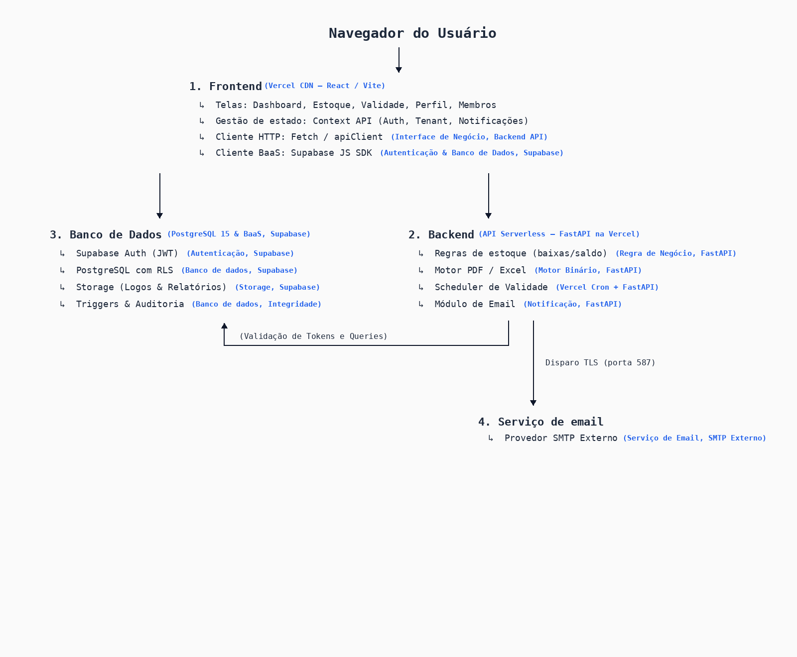
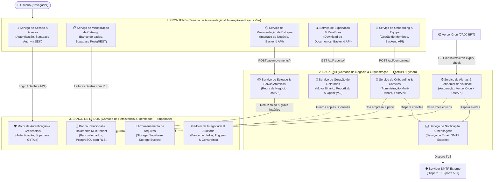

# Arquitetura do Valida Fácil (Visão de Serviços & Camadas)

- **Diagrama Esquemático (Estilo Folha / Desenho):** [`./arquitetura_esquema.png`](./arquitetura_esquema.png)
- **Diagrama de Blocos Detalhado:** [`./arquitetura.png`](./arquitetura.png)

---

## Detalhamento dos Serviços por Camada

A aplicação opera como um **Monólito Modular**: o código está organizado por domínios de responsabilidade bem delimitados (comportando-se como microsserviços lógicos), distribuído estritamente entre as três camadas abaixo:

---

### 1. Camada de Frontend (Interface & Interação)
*Hospedada na CDN global da **Vercel** (`frontend/src/`). O código executa 100% no navegador do cliente.*

- **Serviço de Sessão & Acesso `(Autenticação, Supabase)`:**
  - *Onde está:* Frontend (`src/context/AuthContext.jsx`).
  - *Como é implementado:* Utiliza a biblioteca `@supabase/supabase-js` para autenticar credenciais contra o Supabase Auth, armazenar o JWT na sessão do navegador e fornecer o estado global do usuário logado e sua empresa para todas as telas.
- **Serviço de Visualização de Catálogo `(Banco de dados, Supabase)`:**
  - *Onde está:* Frontend (`src/pages/ProductsPage.jsx`, `src/pages/DashboardPage.jsx`).
  - *Como é implementado:* Faz leituras diretas e reativas das tabelas `products` e `categories` via PostgREST. A segurança e o isolamento entre empresas não dependem do frontend: o PostgreSQL filtra automaticamente as linhas pelo token JWT enviado.
- **Serviços de Movimentação, Relatórios e Equipe `(Camada de Negócio, Backend API)`:**
  - *Onde está:* Frontend (`src/lib/apiClient.js` e páginas correspondentes).
  - *Como é implementado:* Consome endpoints REST da FastAPI enviando o token JWT no cabeçalho `Authorization: Bearer <token>`. O frontend não executa regras matemáticas de estoque nem gera PDFs diretamente; ele apenas coleta os inputs do usuário, despacha para a API e exibe o feedback visual.

---

### 2. Camada de Backend (Regras de Negócio & Orquestração)
*Executada sob demanda como Serverless Functions na **Vercel** (`backend/app/`). Não armazena estado em memória.*

- **Serviço de Estoque & Baixas Atômicas `(Regra de Negócio, FastAPI)`:**
  - *Onde está:* Backend (`app/routers/movements.py` e `app/services/movement_service.py`).
  - *Como é implementado:* Valida o saldo do produto antes de qualquer baixa para impedir estoque negativo, insere o registro imutável no livro de movimentações e confere se a operação requer disparo de alerta preventivo.
- **Serviço de Alertas & Scheduler de Validade `(Automação, Vercel Cron + FastAPI)`:**
  - *Onde está:* Backend (`app/routers/alerts.py` e `app/services/expiry_service.py`).
  - *Como é implementado:* A Vercel executa um cron diário chamando a rota `/api/alerts/cron-expiry-check` autenticada via `CRON_SECRET`. O serviço localiza todos os produtos cujo vencimento está dentro da janela crítica (ex: 15 dias) e aciona o módulo de envio.
- **Serviço de Geração de Relatórios `(Motor de Documentos, ReportLab & OpenPyXL)`:**
  - *Onde está:* Backend (`app/routers/reports.py`, `app/services/pdf_service.py` e `excel_service.py`).
  - *Como é implementado:* Recebe os parâmetros de filtro (período, categoria, alertas), busca os dados no PostgreSQL e compila binários puros (PDF vetorial formatado para impressão ou planilha XLSX para auditoria financeira) devolvidos via stream HTTP para download instantâneo.
- **Serviço de Onboarding & Convites `(Administração Multi-tenant, FastAPI)`:**
  - *Onde está:* Backend (`app/routers/companies.py` e `app/services/company_service.py`).
  - *Como é implementado:* Garante a atomicidade na criação da empresa e do perfil `admin` inicial. No convite de colaboradores, gera o convite no banco, associa o papel (`admin`/`operador`) e despacha o e-mail de acesso.
- **Serviço de Notificação & Mensageria `(Serviço de Email, SMTP Externo)`:**
  - *Onde está:* Backend (`app/services/email_service.py`).
  - *Como é implementado:* Módulo que monta templates de e-mail HTML estilizados e realiza conexão autenticada via TLS com o provedor SMTP configurado nas variáveis de ambiente (`SMTP_HOST`, `SMTP_PORT`, `SMTP_USER`, `SMTP_PASSWORD`).

---

### 3. Camada de Banco de Dados (Persistência, Identidade & Segurança)
*Provida pelo cluster gerenciado do **Supabase** (`frontend/supabase/schema.sql`).*

- **Motor de Autenticação & Credenciais `(Autenticação, Supabase)`:**
  - *Onde está:* Supabase GoTrue (`auth.users`).
  - *Como é implementado:* Gerencia senhas criptografadas (hashing seguro), fluxo de recuperação de senha e emissão de tokens JWT contendo a identidade do usuário.
- **Banco Relacional & Isolamento Multi-tenant `(Banco de dados, Supabase / PostgreSQL)`:**
  - *Onde está:* PostgreSQL 15+ (`companies`, `products`, `profiles`, `stock_movements`, `categories`).
  - *Como é implementado:* Todas as tabelas possuem **Row Level Security (RLS)** ativo. Toda query é filtrada nativamente no motor do PostgreSQL: cada usuário só tem visibilidade e permissão sobre linhas vinculadas ao seu `company_id`.
- **Motor de Integridade & Auditoria `(Banco de dados, PostgreSQL Triggers)`:**
  - *Onde está:* PostgreSQL (`schema.sql`).
  - *Como é implementado:* Triggers e constraints nativas (chaves estrangeiras `CASCADE`/`SET NULL`, unicidade de CNPJ, auto-atualização de timestamps) garantindo que o banco permaneça íntegro mesmo se uma requisição externa falhar.
- **Armazenamento de Arquivos `(Storage, Supabase Storage)`:**
  - *Onde está:* Bucket `reports` no Supabase Storage (compatível com S3).
  - *Como é implementado:* Guarda logotipos corporativos e relatórios históricos gerados pelo sistema com controle de permissão por URL assinada.
